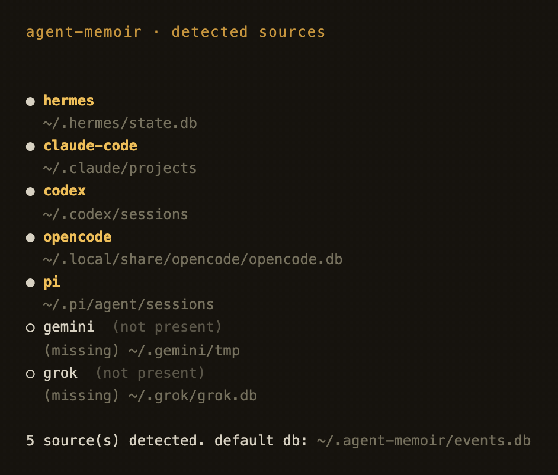
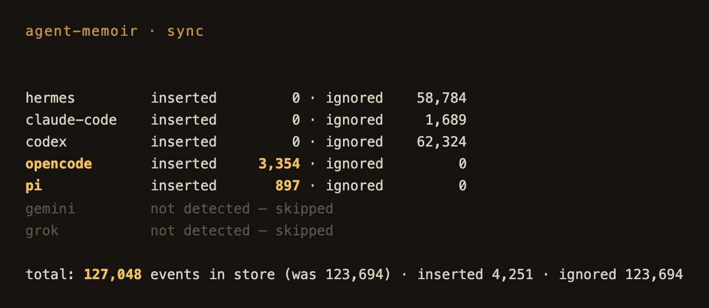
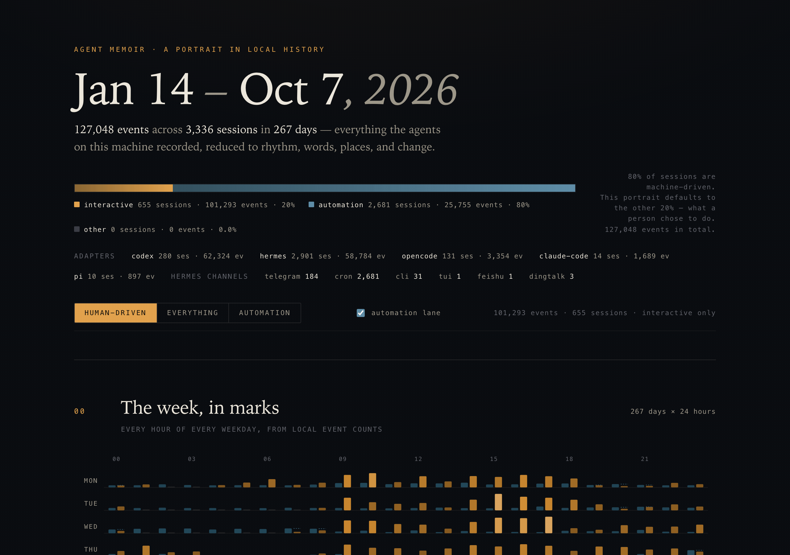
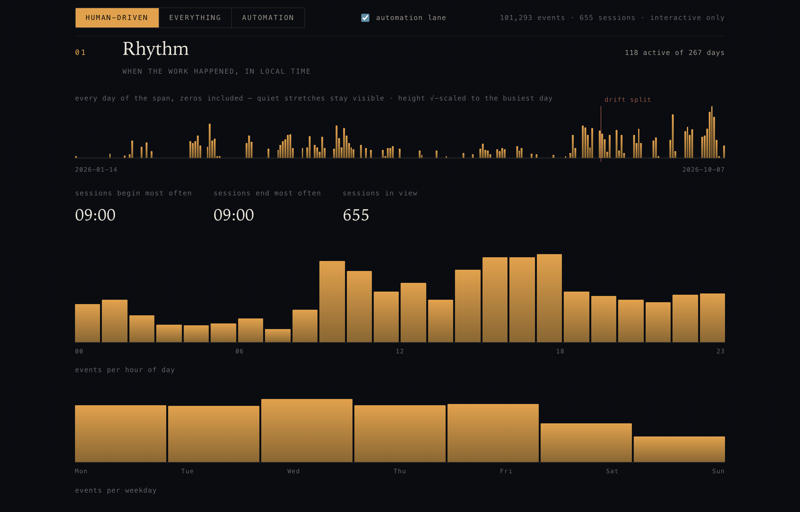
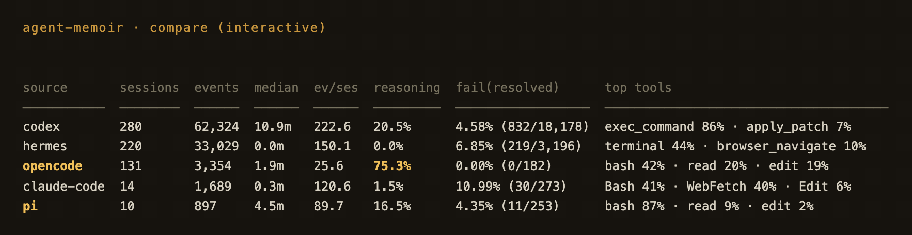
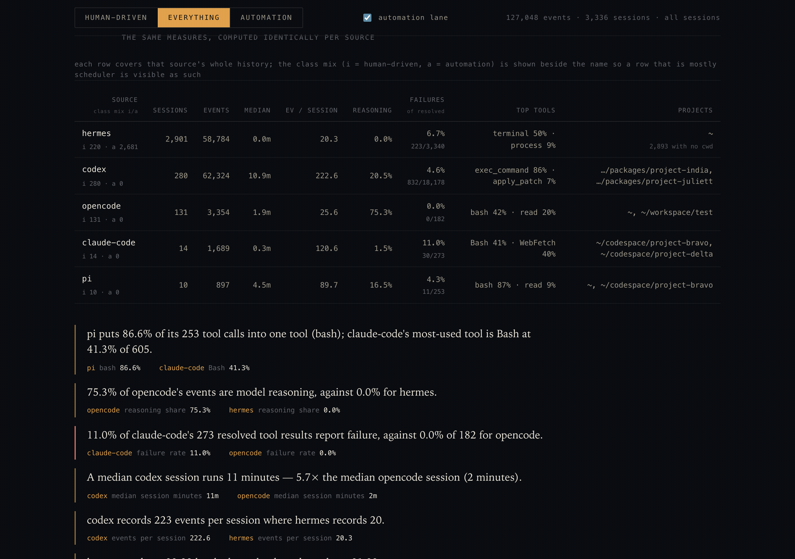

# agent-memoir

A portrait of one person's working life, reconstructed from the local histories
of the AI agents they ran: Hermes, Claude Code, Codex, OpenCode, pi, Gemini
CLI, and Grok CLI are normalized into one `Event` stream, analyzed into a
`Portrait`, and rendered as a static site.

```
sync → MemoirStore (SQLite) → analyzeAll() → Portrait → renderPortrait() → static site
```

## What it looks like

Real output from this machine (267 days, 127,048 events across seven
adapters — projects shown as `~`-redacted slugs, no session ids, no
conversation text).

`init` discovers the local agent stores; `sync` ingests them idempotently:

<p>
  
  
</p>

The rendered portrait — masthead with the class ledger, then the rhythm
chapter (day-by-day activity, hour-of-day and weekday profiles):

<p>
  
  
</p>

`compare` puts the sources side by side on identical measures — the same
table the portrait renders in its "agents, side by side" chapter:

<p>
  
  
</p>

## Adapters

Builtin adapters live under `src/adapters/<id>/` (one `index.ts` for discovery
and row reading, one `normalize.ts` for row → Event mapping) and are declared
in `registry.json`:

- `hermes` — `~/.hermes/state.db` (SQLite, opened `?immutable=1`).
- `claude-code` — `~/.claude/projects/*.jsonl`, one JSONL per session plus
  `subagents/` transcripts; sidechain rows key off `isSidechain`, not filenames.
- `codex` — `~/.codex/sessions/YYYY/MM/DD/rollout-*.jsonl`, one self-describing
  envelope per line; the line's own `ordinal` keys the sequence.
- `opencode` — `~/.local/share/opencode/opencode.db` (SQLite, opened
  `?immutable=1` like Hermes/Grok); `message` rows + `part` rows, where a
  `tool` part fans out into its call and its result.
- `pi` — `~/.pi/agent/sessions/<project-slug>/*.jsonl`, one row per line
  (`session` / `model_change` / `message`); user prompts, assistant text,
  thinking blocks, tool calls, and `toolResult` rows all map.
- `gemini` — `~/.gemini/tmp/<project>/chats/session-*.jsonl` (first line is
  the conversation metadata; `$patch` / `$rewindTo` records are dropped, and
  a `gemini` record fans out into text / thoughts / toolCalls).
- `grok` — `~/.grok/grok.db` (SQLite, `?immutable=1`); each `message_json`
  row is an AI SDK `ModelMessage`, fanned out into text / thinking /
  tool-call / tool-result parts keyed by the stable per-session `seq`.

Every adapter is read-only on its source, streams `RawEvent`s, and returns
`null` from `normalize()` for telemetry rows rather than inventing content.

## CLI

```sh
bun run cli -- init                             # detected sources and their paths
bun run cli -- sync                             # ingest everything (idempotent)
bun run cli -- stats --class interactive        # analysis summary to stdout
bun run cli -- portrait --out ./portrait        # write the static site
bun run cli -- search "apply_patch" --limit 5   # query the unified stream
bun run cli -- compare                          # per-source table + contrasts
bun run cli -- friction --class interactive     # what keeps going wrong
bun run cli -- report --out ./report.md         # shareable markdown (aggregates only)
bun run cli -- export                           # one Insight JSON, aggregates only
```

`sync`, `stats`, `portrait`, `search` and `report` share `--db <path>`,
defaulting to `~/.agent-memoir/events.db`.

`export` and `report` are the two commands that emit anything that may leave
the machine. Both pass `assertExportable()`; `report` is additionally assembled
only from Insight-shaped aggregates and is checked for home paths and
identifier-shaped tokens before it is written. `search --json` is the opposite:
it is **local-only** output for scripting, it may contain session ids, and it is
never routed through the export path.

## Agent skill

An official agent skill for this project is distributed through
[cc-skills](https://github.com/volcanicll/cc-skills) — a step-by-step manual
that lets AI coding agents (Claude Code, Codex CLI, and other Agent Skills
compatible hosts) drive this CLI for you: detecting local agent stores,
syncing the unified event stream, querying stats and cross-source search,
comparing agents, analyzing friction, and generating reports or the portrait
site.

```sh
npx skills add volcanicll/cc-skills --skill agent-memoir
```

The skill is documentation-only; the tool itself lives in this repository and
is the only thing the skill operates on.

## Search

`search "<query>"` supports a small closed grammar rather than SQL: free text
(tokenized with the CJK-aware tokenizer), `"quoted phrases"` as exact
substrings, and the filters `source:`, `class:`, `project:`, `tool:`, `kind:`,
`after:YYYY-MM-DD` and `before:YYYY-MM-DD`. An unknown `key:value` is a
**reported error**, never a silently ignored term.

Free text is served by an FTS5 index (available in `bun:sqlite`) stored in the
memoir's own database — contentless, so it costs ~41 MB rather than ~153 MB for
a duplicate of the body, with a rid→event_id map bridging back to `events`. The
index is built on first search (≈3.5 s for 122k events) and updated
incrementally after `sync`. Measured p50 on this machine's 122k-event store:
2–15 ms per query.

## Friction

`friction` reports four families, each with its evidence: repeated failures
(the same tool + normalized arguments returning `ok:false` at least three
times, recovered by pairing each result to its call), long tool loops (≥50
tool-call pairs with no human turn between), reverted work (one path written
more than once in a session with different content — a heuristic over
summarized args, not a git diff), and abandoned sessions. The findings carry
command lines and paths for local display; the rendered portrait shows counts,
tool names and redacted path labels only, and the shareable report shows counts
and categories only.

## Session classes

Measured here: 84% of sessions are `cron`. A portrait over raw totals would
describe a scheduler, so every aggregate is computed per class and the site
defaults to `interactive`:

- `automation` — Hermes `cron` sessions (their `user` turns are written by a
  scheduler, so role alone cannot prove authorship), plus any session that is
  nothing but tool traffic.
- `interactive` — sessions from a human-driven source (telegram, cli, dingtalk,
  feishu, tui, acp; Claude Code and Codex) carrying an authored user turn.
- `other` — everything else: unlabeled, unknown-sourced, or empty. Reported as
  its own bucket, never folded into the other two.

## Privacy

`RawEvent` and `Event` are local-only; `Insight` is the only exportable shape.
Home paths are replaced with `~` at a single point (`src/analyze/redact.ts`,
one `HOME_REDACTION` constant), and `renderPortrait` asserts no home prefix
survives into `index.html`, `portrait.css`, or `portrait.js` before writing.

## Verification

```sh
bun run typecheck        # tsc --noEmit
bun test                 # unit tests: tokenizer, classifier, streak/gap, drift,
                         # query parser, redaction, friction, search, report
bun run verify           # all four gates, in order
bun run verify:real      # just Phase 0 (this machine's sources)
bun run verify:fixtures  # just the adapter fixtures
bun run verify:portrait  # just the Phase 1 portrait gate
bun run verify:phase2    # just the Phase 2 gate
```

`verify:real` streams this machine's sources; the other three run against
checked-in synthetic fixtures, so they are reproducible anywhere.

The portrait gate builds a store from a fixed 490-event fixture, asserts
hand-computed analysis numbers, renders the site to a temp directory, then
drives headless Chrome to prove the page is neither blank (PNG size against a
blank-page reference) nor empty in the DOM (section markers and real numbers in
`--dump-dom`).

The phase 2 gate builds a second fixture that deliberately plants a repeated
failure (through the call→result pairing the adapters require), a long tool
loop, a rewrite with an exact revert and an abandoned session — and asserts
that a clean session produces no finding at all. It also rejects a mistyped
query filter, checks that every emitted contrast carries both source numbers,
parses the shareable report and checks it for paths, session ids, uuids and
conversation text, and measures search latency against a copy of the real store
against a stated budget.
